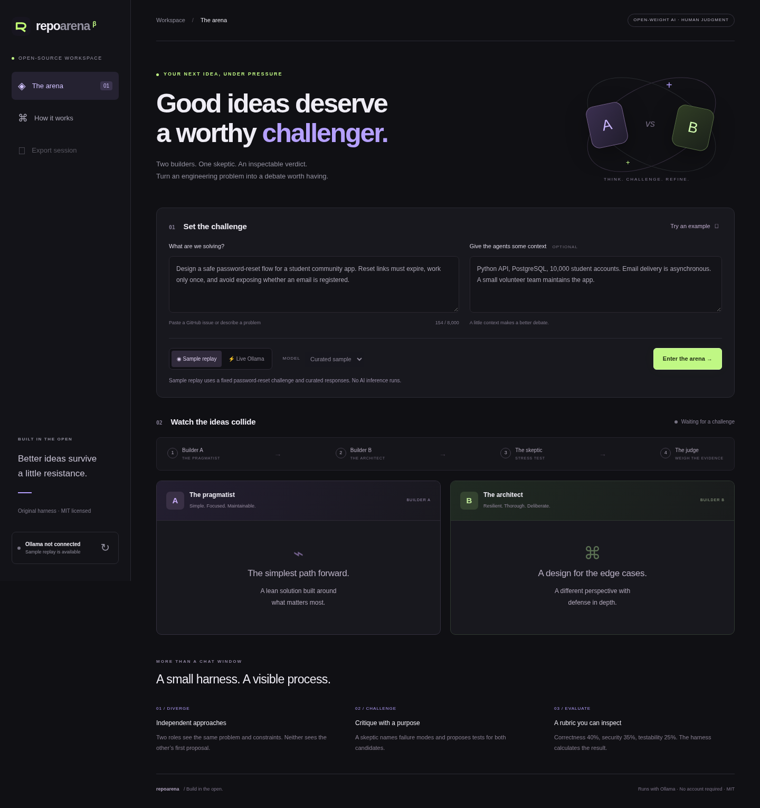

# RepoArena

**Good ideas deserve a worthy challenger.**

RepoArena is an original open-source AI harness that turns an engineering issue into a structured debate. Two independent builders propose solutions, a skeptic identifies failure modes, and a judge scores the evidence. You can inspect every prompt and response, then export the entire session.

Built for the **Best Open-Source AI Project** challenge. Live runs use an open-weight instruction model through [Ollama](https://ollama.com/). The app and harness are MIT licensed; model weights have their own licenses.



## Run it

Requires **Python 3.10+**. The application has **zero third-party Python or JavaScript dependencies**.

```bash
python -m repoarena.server
```

Run this from the repository root. Open your browser on port **8000** on the same computer. Sample replay works immediately and is explicitly labeled as curated data with **no inference**.

### Run real AI with Ollama

Install [Ollama](https://ollama.com/download) on the same computer as RepoArena. Start Ollama if its desktop application is not already running:

```bash
ollama serve
```

In another terminal, pull an instruction model. For example:

```bash
ollama pull qwen2.5:3b
ollama list
python -m repoarena.server
```

If the app is already running, leave it running. Click the connection refresh icon in its sidebar, select **Live Ollama**, choose a model, enter a challenge, and click **Enter the arena**. A run makes four sequential inference calls; smaller machines can take several minutes. A larger instruction model may follow the JSON schemas more reliably. Check the selected model's license before redistributing weights.

The server discovers installed models through `/api/tags`; inference uses `/api/chat` with JSON output mode. No API key is needed for local Ollama. There is no automatic sample fallback if inference fails.

For a separately hosted Ollama server, set `OLLAMA_HOST` before starting RepoArena:

```bash
OLLAMA_HOST=http://your-model-server:11434 python -m repoarena.server
```

Cloud `localhost` refers to the cloud machine, not your laptop. The simplest presentation setup is to run both Ollama and this app locally. Use only a trusted model endpoint: prompts and repository context are sent to that endpoint. Keep the default loopback binding for local use; this development server has no authentication and is not a public multiuser deployment.

## What makes this an original harness?

The orchestration is implemented here, without an agent framework:

1. **Builder A / pragmatist:** proposes a maintainable solution with few moving parts.
2. **Builder B / architect:** independently proposes a resilient design. It does not see A's answer.
3. **Skeptic:** receives both proposals, identifies risks, and proposes concrete tests.
4. **Judge:** receives the original issue, proposals, and critique, and scores correctness, security, and testability.

The harness validates every response against a stage-specific structure. Python computes weighted totals: **40% correctness, 35% security, 25% testability**, rounded to two decimal places with decimal half-up rounding. Equal rounded totals produce a tie. A model-supplied winner cannot override these totals.

The browser receives progress events as newline-delimited JSON. Exported sessions include the issue, context, model name, mode, rubric, UTC timestamp, stage prompts, raw responses, validated results, and inference timing. Sessions remain in browser memory unless explicitly downloaded.

### Why open-weight AI matters

Live proposals, critiques, and rubric assessments are generated by the selected model. Removing the model removes the app's ability to evaluate a new challenge. The sample is a single fixed presentation fixture, not an evaluator. Different roles use the same selected model; they are separate prompts, not separate trained models.

## Features

- Two candidate solutions side by side, with implementation steps and tradeoffs.
- Visible stage progress during live inference.
- Risk and test suggestions for each proposal.
- Weighted verdict calculated by the harness.
- Inspectable prompts, raw output, token counts, and timing.
- JSON evidence export.
- Mobile-friendly interface, keyboard focus states, and reduced-motion support.
- Explicit sample replay for learning the workflow without downloading a model.
- Input limits, timeouts, bounded concurrent runs, and escaped model text.

## Test

```bash
python -m unittest discover -s tests -v
node --check web/app.js
```

Python tests need only the standard library. Node is needed only for the optional JavaScript syntax check. Tests cover score validation and ties, proposal independence, evidence capture, provider failure, HTTP input validation, sample execution, and the real HTTP adapter against a **simulated** Ollama server. Those adapter tests do not run model inference.

The included GitHub Actions workflow runs the Python suite and JavaScript syntax check on pushes and pull requests.

## Demo in 90 seconds

1. Explain the problem: a single AI answer often hides its assumptions.
2. In live mode, load the example password-reset issue and select your open-weight model.
3. Start a debate. Explain the two builders' different priorities while inference runs.
4. Show the skeptic's concrete failure modes and proposed tests.
5. Inspect the scoring rubric and compare the designs.
6. Open **Inspect the harness** and export the evidence.
7. Explain the limit: model judgment is a review aid, not a substitute for running tests or human review.

If presenting sample mode, explicitly say it is a curated replay. For a challenge submission, run a real model and retain its exported session as evidence.

## Layout

```text
repoarena/harness.py   Original orchestration, validation, scoring, Ollama adapter
repoarena/server.py    HTTP API, streaming events, static asset serving
web/                  Browser interface; no build tool or external assets
tests/test_arena.py    Harness and HTTP integration tests
docs/                 Build plan and submission checklist
```

## Limitations

- Scores are subjective model assessments. The harness does not execute candidate code or the proposed tests.
- Prompt injection defenses are instruction-based, not a security boundary; do not include secrets in pasted context.
- The same model can share biases across all roles. This is not independent expert consensus.
- Invalid or truncated model JSON stops a run with an error. Try a larger instruction model or a shorter challenge.
- One generation has a 180-second timeout; full runs can take longer. Closing the page does not immediately cancel an in-flight Ollama request.
- No GitHub issue import, account system, database, or production hosting is included. Paste an issue into the app.

## Contributing

Open an issue with a concrete task, create a branch, keep commits focused, and open a draft PR with validation results. See [CONTRIBUTING.md](CONTRIBUTING.md). Team registration and actual GitHub collaboration history must be completed honestly; this repository does not fabricate either.

## License

[MIT](LICENSE). Model licenses are separate from the application license.
